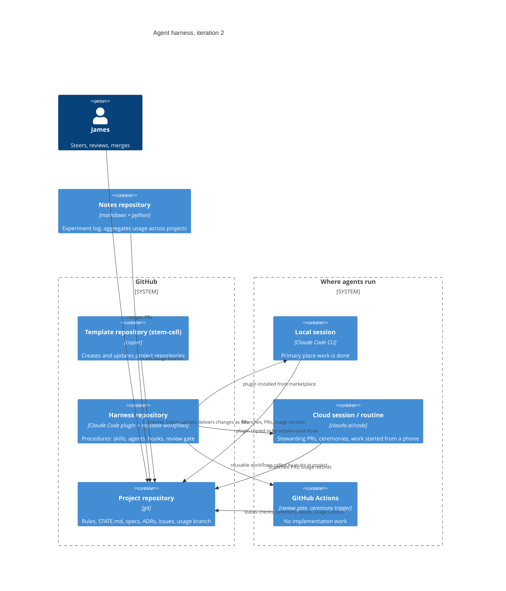
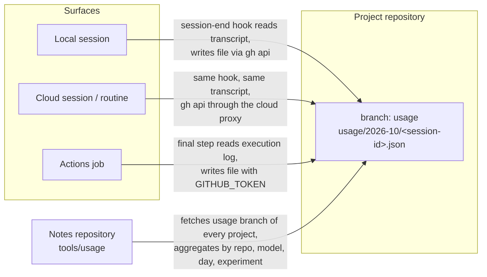

# Proposal: agent harness, iteration 2

Date: 2026-10-11
Status: for review. Merging this PR approves the design, the decisions in
section 8 as marked, and the phases in section 9.
Audience: James, and any agent implementing a phase. No prior knowledge of
the earlier projects is assumed.

## 1. Summary

- A template creates repositories that agents can operate. Each repository
  contains its rules, its current state, its specifications, its decisions,
  and the wiring for review and data capture.
- A plugin provides the procedures agents follow. Procedures are not copied
  into repositories.
- GitHub Issues is the only task queue.
- A human approves work by merging a pull request. There is no other
  approval step.
- Every surface that runs an agent writes a record of what it used (model,
  tokens, cost estimate, duration, attribution) to the repository it worked
  in. Nothing is lost if no server is listening.
- Recurring maintenance (grooming, state check, structural review, retro)
  is triggered by merge count and executed by whichever agent or person
  picks up the resulting issue.

## 2. Goal and constraints

Goal: run software projects where agents implement and a person steers and
approves, with the person able to leave for months and return without
reconstructing what happened.

Constraints:

| Constraint | Reason |
|---|---|
| No API billing. Everything runs on a Claude Max subscription. | Cost control. Rules out tools that need an API key. |
| Every merge is made by James. | Quality control and accountability. |
| Works on any machine from one install. | James moves between machines. |
| Survives neglect. | Returns are intermittent. State must be in the repositories, not in anyone's memory. |

## 3. Background

Two earlier attempts exist. This iteration keeps parts of each.

### 3.1 stem-cell, May 2026

A copier template. Copier is a tool that takes a folder of files with
placeholders, asks the user a few questions, and writes out a complete
repository. Later, `copier update` re-applies template changes to a
repository that was created from it, as a diff.

| Kept | Dropped | Why dropped |
|---|---|---|
| `copier update` as the way template changes reach every repository | A task queue (SQLite, exposed as an MCP server) copied into every repository | Duplicated GitHub Issues. Two task stores diverge. |
| `STATE.md`: a file recording what the repository currently runs and depends on | A GitHub Actions workflow that ran Claude inside CI to implement work | Slow, opaque, and consumed subscription quota in a place with no human nearby. |
| The ceremony cadence: maintenance activities that fire every N merged PRs | A separate bot identity for agent PRs, on by default | Only useful if someone other than James needs to see agent PRs as separately authored. |
| One repository, one purpose | Nine process documents per repository | Agents spend context reading them. Most content belongs in procedures, not in each repository. |

### 3.2 harness, August to September 2026

A Claude Code plugin (skills, agents, hooks) and a reusable GitHub Actions
workflow that reviews every PR with an agent. It ran one project,
chord-recommender, to about sixty merged PRs in twelve days.

| Kept | Dropped or changed | Why |
|---|---|---|
| Specification PR as the single approval point | A copy-once project template | No way to deliver fixes to repositories already created. |
| Architecture decision records | A hook in each repository that copies the plugin into place for cloud sessions | Hand-maintained in each repository. Replaced by the template writing it. |
| A fresh-context reviewer agent as a required status check | A roadmap file as the record of progress | It went stale within weeks. Progress is recorded in the notes repository instead. |
| One issue, one PR, reviewable in under ten minutes | Sizing decided by whichever agent picked up the work | Replaced by a written routing rule. |
| The `proposal` label: PRs that ask an opinion skip the agent reviewer | No capture of usage, cost, review rounds, or time at the gate | Replaced by section 6. |
| Steward posture: how an agent behaves when watching a PR | The harness repository's own PRs not being reviewed | Phase 1 adds the gate to the harness. |
| Cloud sessions and self-rearming routines for overnight work | | |

### 3.3 Research, October 2026

A review of published spec-driven development frameworks found:

- Spec completeness (acceptance criteria, non-goals, constraints, open
  questions) predicted outcomes more than framework choice.
- Specs paid off on work spanning several sessions or several files, and
  added overhead on small changes.
- Specs drift from code after implementation starts. Two leading tools
  added a step that checks the implementation against the spec and
  updates the spec.
- Project context accumulating in instruction files degrades output.
  Moving reusable guidance into skills reduced it.

## 4. Design overview

Three repositories have fixed roles:

| Repository | Holds | Changes reach projects by |
|---|---|---|
| Template (stem-cell) | Files every project starts with | `copier update`, producing a PR in each project |
| Harness | Skills, agents, hooks, reusable workflows | Plugin marketplace (local), session-start hook (cloud), workflow reference (Actions) |
| Project | Everything specific to one piece of software | n/a |

## 5. Components

### 5.1 What a project repository contains

| Path | Purpose | Origin |
|---|---|---|
| `README.md` | Purpose in one paragraph; directory map | Template |
| `CONTRIBUTING.md` | Rules: branches, commit format, one issue per PR, labels, the routing rule in 5.6, the usage-data location in section 6 | Template |
| `STATE.md` | What is running, where, and what it depends on. Updated in the same PR as any change to those facts | Template (from stem-cell) |
| `CEREMONIES.md` | The maintenance catalogue: name, period, inputs, outputs | Template (from stem-cell, revised) |
| `CLAUDE.md`, `AGENTS.md` | Agent entry points. Short: read CONTRIBUTING, STATE and the spec; use skills for procedures | Template |
| `specs/` | Living specifications. One stub created at project creation, seeded from the purpose | Template (from harness) |
| `docs/adr/` | Architecture decision records | Template (from harness) |
| `.claude/settings.json` | Plugin marketplace pointer; hook registrations | Template |
| `.claude/hooks/session-start.sh` | Installs dependencies; in cloud sessions, copies the plugin in because marketplaces do not install there | Template, from harness source |
| `.claude/hooks/pretooluse.sh` | Guards: no push to main, identity check | Template, from harness source |
| `.claude/hooks/session-end.sh` | Writes the session's usage record (section 6) | Template, new |
| `.github/workflows/claude-review.yml`, `claude-fix.yml` | Call the harness's reusable review and fix workflows. Pinned to a harness tag chosen at creation | Template (from harness) |
| `.github/workflows/ceremonies.yml` | On each merged PR: count merges, apply the modulo rule, open ceremony issues (5.5) | Template, new |
| `.github/ISSUE_TEMPLATE/feature-request.yml` | Request from another repository. Required fields define what one repository must tell another | Template, new |
| `.copier-answers.yml` | Which template version this repository was created from | Copier |
| Branch `usage` | Usage records, one file per session or job (section 6) | Written by hooks and workflows |

Not included, by decision: a task queue, a workflow that implements work in
CI, a bot identity (available as an option), a manifesto, a changelog, a
separate testing document (content moves into CONTRIBUTING).

### 5.2 What the plugin contains

| Skill or agent | Status | Purpose |
|---|---|---|
| `spec` | Existing | Create or update a living spec; open it as a `proposal` PR |
| `plan` | Existing | Decide technical approach between spec and task breakdown |
| `split-spec` | Existing | Break a spec into issues sized for one PR each |
| `dispatch` | Existing | Start agents on ready issues, one worktree each |
| `ship` | Existing | Run checks, self-review, open the PR |
| `adr` | Existing | Record a decision |
| `reviewer` agent | Existing | Fresh-context review of a diff against spec and ADRs |
| `steward` | Existing | How to behave when watching a PR: fix important findings, do not grind on minor ones |
| `scope` | New | Route an issue: plan mode or spec (5.6) |
| `converge` | New | After a PR merges against a spec delta, check the merged code against the delta's acceptance criteria; fold the delta into the spec or file an issue |
| `ceremony` | New | Procedures for the four ceremonies (5.5) |
| `queue` | New | Verbs over GitHub Issues: idea, scope, claim, complete, request-feature. Keeps an agent's interface stable if the backend changes |

### 5.3 What runs in GitHub Actions

Two jobs, both deterministic. Neither implements anything.

| Job | Trigger | Does |
|---|---|---|
| Review gate | PR opened or updated | Classifies the PR (proposal, gate change, or normal); runs the reviewer agent in a loop with a fixer; publishes a required status check |
| Ceremony trigger | PR merged | Counts merged PRs on the default branch; for each ceremony whose period divides the count, opens one issue labelled `ceremony` and `agent-task`; never opens the same issue twice |

### 5.4 Where agents run

| Surface | Used for | Plugin available how |
|---|---|---|
| Local session | Implementation, specs, decisions. The primary surface | Marketplace install |
| Cloud session or routine | Stewarding open PRs, executing ceremony issues, work started from a phone | Copied in by the session-start hook |
| GitHub Actions | The two jobs in 5.3 only | Reusable workflows referenced by the stubs |

### 5.5 Ceremonies

A ceremony is a maintenance activity with a fixed period, measured in
merged PRs. After PR number k merges, ceremony i fires if k mod n_i = 0.
Periods are starting values; the retro changes them.

| i | Ceremony | Period n_i | Inputs | Output |
|---|---|---|---|---|
| 1 | Backlog grooming | 5 | Open issues; merged PRs since last grooming | Issues routed (5.6), closed, re-prioritised; any spec with several pending deltas assessed for splitting |
| 2 | State and spec check | 10 | `STATE.md`, `specs/`, the running system | Stale text folded or deleted; a PR with the corrections |
| 3 | Structural review | 20 | Code and ADRs | Issues for structural problems; ADRs where a decision was made implicitly |
| 4 | Retro | 15 | Usage records (section 6), review rounds per PR, PR sizes, rework on direct-routed work | A PR to `CONTRIBUTING.md` proposing changed thresholds or periods |

Trigger: the Actions job in 5.3 opens the issue. Execution: whoever picks
the issue up. A routine, a cloud session, or James's next local session.
Procedure: the `ceremony` skill.

### 5.6 Routing work

Applied by the `scope` skill when an issue is picked up. The route is
written on the issue.

| Expected size | Route |
|---|---|
| Fewer than six files and one session | Plan mode, then a PR |
| More than that, or several sessions, or several agents, or a change to a public contract | `/spec`, then `split-spec` |

The thresholds are stored in `CONTRIBUTING.md` so the retro can change them.

## 6. Usage data

### 6.1 Requirement

Every agent session and every automated job records what it consumed, in a
form that can be collected and analysed later. Live transmission to a
server is not required. Data must not be lost when no server is available.

### 6.2 What is recorded

One record per API call, grouped into one file per session or job:

| Field | Source |
|---|---|
| timestamp, session id, surface (local, cloud, actions) | hook or job environment |
| repository, branch | git |
| experiment tag, if set | `.claude/settings.local.json` on the machine |
| model, effort | Claude Code |
| input tokens, output tokens, cache write tokens, cache read tokens | Claude Code |
| estimated cost in USD at list price | Claude Code |
| duration | Claude Code |
| skill, agent, plugin attribution where available | Claude Code |

Claude Code already produces all of these. In a local or cloud session they
are in the session transcript, a JSON lines file Claude Code writes as it
runs. In an Actions job they are in the execution log the review action
produces.

### 6.3 Where it is stored

Each project repository has a branch named `usage`, with no shared history
with `main`. It holds one JSON file per session or job, named by date and
id. A writer only ever creates a new file, so concurrent writers do not
conflict.

Why the repository and not a server:

- Every surface already has write access to the repository it works in.
  No new credential, endpoint, or network path.
- A cloud session or Actions job has no way to reach a server on James's
  laptop. A git branch is reachable from all three.
- The data is versioned, backed up, and inspectable with ordinary tools.

### 6.4 How each surface writes

| Surface | Mechanism |
|---|---|
| Local session | `SessionEnd` hook, registered by the template in `.claude/settings.json`. Claude Code passes the hook the transcript path. The hook summarises the transcript into one file and creates it on the `usage` branch with `gh api` |
| Cloud session, routine | The same hook. Repository hooks run in cloud sessions. `gh api` is built into cloud sessions and is authenticated through the proxy |
| Actions job | A final step in the reusable workflow reads the review action's execution log and creates the file with `GITHUB_TOKEN`, which has contents write permission |

### 6.5 How it is read

The notes repository's `tools/usage` fetches the `usage` branch of each
project repository and aggregates by repository, model, day, experiment,
skill, and surface. The retro ceremony runs it. The existing
transcript-based and OpenTelemetry-based tools remain as local
cross-checks.

### 6.6 What this does not do

- It does not transmit anything live. A local OpenTelemetry collector
  exists on James's laptop and continues to receive local sessions; it is
  not part of this design and nothing depends on it.
- It does not capture work done outside a repository, such as a session
  started in an empty directory.
- It does not record prompt or response text.

## 7. What is new in this iteration

Not present in either earlier attempt:

- Template changes carrying the review gate and hooks into existing
  repositories.
- GitHub Issues as the only queue, with an issue template as the contract
  between repositories.
- A written routing rule with thresholds the retro can change.
- A step that checks merged code against the spec and updates the spec.
- A ceremony trigger that needs no state and no memory.
- Usage records written to the repository by every surface.
- The harness repository's own PRs reviewed by the gate.

## 8. Decisions for James

| ID | Decision | Options | Recommendation |
|---|---|---|---|
| D1 | Where the template lives | stem-cell in place; or a new repository with stem-cell archived | stem-cell in place. The copier setup and history are there |
| D2 | Bot identity | On by default; off by default, available as an option | Off by default |
| D3 | Who executes ceremony issues | A routine; a cloud session; James's next local session; no default | No default in phase 1. Whoever picks the issue up |
| D4 | Pinning | Skills follow the marketplace; workflows pinned to a tag chosen at creation | As stated. This is the harness's existing decision |
| D5 | First project created from the template | The AWS research-compute repository; or a throwaway | The AWS repository. It needs a spec and has consequences |
| D6 | Usage data store | Per-repository `usage` branch; a central repository; a server | Per-repository branch. No cross-repository credential needed |

## 9. Phases

| Phase | Delivers | Exit test |
|---|---|---|
| 1. Minimum project | Template creates everything in 5.1 except ceremonies and the issue template. Session-end hook and Actions usage step included. Harness repository gets its own review gate | A PR in the first project is reviewed by the gate and merged. Three usage files exist on its `usage` branch: one from the local session that wrote the PR, one from a cloud session opened on the repository, one from the gate run |
| 2. Issues as the queue | Labels, the feature-request template, `CONTRIBUTING.md` rewritten for issues, the `scope` and `queue` skills | An issue is routed, implemented, merged, and closed by its PR |
| 3. Cadence | `ceremonies.yml` and the `ceremony` skill | The fifth merged PR opens a grooming issue; an agent completes it |
| 4. Closing the loop | `converge`; retro reading usage data | A spec delta is folded by `converge`; a retro PR proposes a threshold change with the numbers behind it |
| 5. Update path | `copier update` run on cytometer, a repository created from the May template | The resulting PR merges with conflicts only in hand-edited files |

Out of scope: the cross-repository coordination layer from May (atlas,
morphogen), until more than three repositories are active.

## 10. Success criteria

After a gap of several months:

- `STATE.md` and `specs/` in any project say where it is.
- Ceremony issues opened during the gap are waiting.
- A template change reaches every project as a PR.
- The retro has changed at least one threshold, citing usage data.
- The usage branches show what every surface consumed.

## 11. Glossary

| Term | Meaning |
|---|---|
| Template | The stem-cell repository: files with placeholders that copier turns into a project repository |
| Project repository | A repository created from the template |
| Harness | The repository holding the plugin and reusable workflows |
| Plugin | A Claude Code package of skills, agents, and hooks, installed from a marketplace |
| Skill | A procedure an agent follows, invoked as `/name` |
| Hook | A script Claude Code runs on an event: session start, session end, before a tool call |
| Gate | The GitHub Actions review workflow that must pass before a PR can merge |
| Ceremony | A maintenance activity triggered every N merged PRs |
| Delta | A pending change written into a spec: what changes, what stays, what is removed, with acceptance criteria |
| Surface | A place an agent runs: local session, cloud session or routine, GitHub Actions |
| Usage record | One file per session or job listing model, tokens, cost estimate, duration, attribution |
